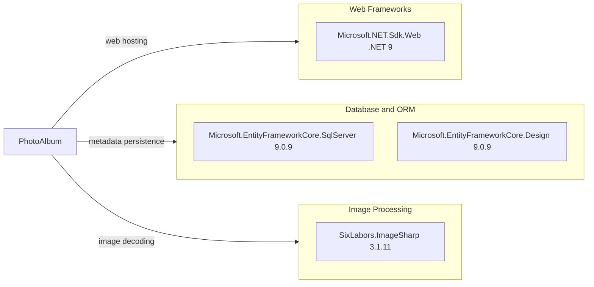

# Dependency Map

PhotoAlbum declares three production package references and six test-project package references. The production dependency map excludes test-only packages; the solution also resolves additional transitive NuGet dependencies.

## Dependencies

### Dependency Summary

| Category | Count | Key Libraries | Notes |
|---|---:|---|---|
| Web Frameworks | 1 | Microsoft.NET.Sdk.Web / ASP.NET Core 9 | Framework supplied by the .NET shared framework |
| Database and ORM | 2 | EF Core SQL Server, EF Core Design 9.0.9 | Design package is private to the application project |
| Image Processing | 1 | SixLabors.ImageSharp 3.1.11 | Used to decode uploads and obtain dimensions |

### Version & Compatibility Risks

The application targets `net9.0`. The direct ImageSharp dependency is 3.1.11 and is reported by the dependency assessment as affected by multiple medium/high-severity advisories; the advisories identify 3.2.0 as the first patched release for the 3.x line. The .NET upgrade assessment also reports package-upgrade and compatibility findings for the .NET 10 target.

### Notable Observations

- SQL Server persistence is configured through EF Core, while test coverage uses EF Core InMemory.
- `Microsoft.EntityFrameworkCore.Design` is marked with private assets in the production project.
- ImageSharp is the only direct third-party production library outside the EF Core packages.

## Test Dependencies

| Framework | Version | Notes |
|---|---:|---|
| coverlet.collector | 6.0.2 | Code coverage collector |
| Microsoft.AspNetCore.Mvc.Testing | 9.0.9 | ASP.NET Core integration-test hosting |
| Microsoft.EntityFrameworkCore.InMemory | 9.0.9 | In-memory database provider for tests |
| Microsoft.NET.Test.Sdk | 17.12.0 | .NET test execution |
| xunit | 2.9.2 | Test framework |
| xunit.runner.visualstudio | 2.8.2 | Visual Studio test adapter |

Total test-scope dependencies: 6

The test project uses xUnit and ASP.NET Core test hosting. Tests are located in `PhotoAlbum.Tests/Unit/Services/`; the project also references the application project.
