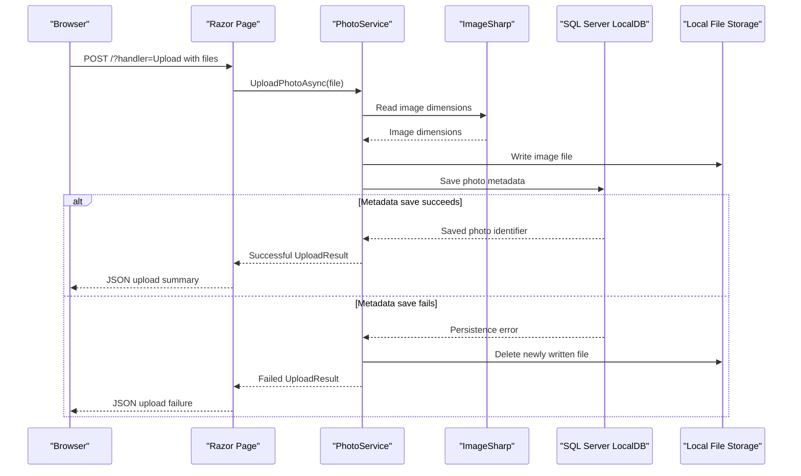

# API & Service Communication Contracts

PhotoAlbum exposes five page-handler HTTP operations for browsing, uploading, viewing, and deleting photos. All application communication is synchronous over HTTP or direct asynchronous service calls; no inter-service API or message broker is configured.

## Service Catalog

| Service | Port | Category | Purpose |
|---|---|---|---|
| PhotoAlbum | Not explicitly configured; uses ASP.NET Core hosting defaults | API Layer | Serves Razor Pages and photo upload, display, and deletion operations |

## API Endpoints Inventory

| Service | Method | Path | Request Type | Response Type |
|---|---|---|---|---|
| PhotoAlbum | GET | `/` | None | Gallery page with photo list |
| PhotoAlbum | POST | `/?handler=Upload` | Multipart form `files` | JSON upload summary; 400 when no files are supplied |
| PhotoAlbum | GET | `/{id?}` | Optional route parameter `id` | Photo detail page; 404 if missing |
| PhotoAlbum | POST | `/{id}?handler=Delete` | Route parameter `id` | Redirect to gallery or detail page |
| PhotoAlbum | GET | `/photo/{id}` | Required route parameter `id` | Image file; 404 if not found and 500 on an unexpected serving error |

## Management & Observability Endpoints

| Service | Endpoint | Custom Metrics |
|---|---|---|
| PhotoAlbum | None identified | None identified |

## DTOs & Contracts

`UploadResult` communicates the outcome of an upload from the service to the page handler. The upload handler returns a JSON object containing uploaded-photo summaries and failed-upload details; these response objects are anonymous types rather than dedicated immutable DTOs. `Photo` is the domain entity used to represent a persisted photo, and the `id` route parameters are primitive values. No gateway-level aggregation DTO, OpenAPI/Swagger specification, protobuf schema, or GraphQL schema was found. JSON serialization uses the ASP.NET Core defaults.

## Communication Patterns

The browser communicates synchronously with Razor Page handlers over HTTP. Page models call `IPhotoService` directly using asynchronous in-process method calls, and `PhotoService` uses EF Core and the local filesystem; there are no downstream network services, asynchronous message queues, service discovery, gateway composition, retries, or circuit breakers.

HTTPS redirection is enabled, and HSTS is applied outside development. The application registers authorization middleware but no authentication scheme or explicit authorization policies were identified; there is no evidence of API-level identity enforcement. Database migrations run during startup unless test mode is configured, so a migration failure prevents the app from starting.

## Service Technology Matrix

| Service | Web | Data Access | Discovery | Gateway | Actuator | Cache | Metrics |
|---|---|---|---|---|---|---|---|
| PhotoAlbum | Razor Pages | EF Core | None | None | None identified | HTTP response caching headers only | None identified |

## Service Communication Sequence

